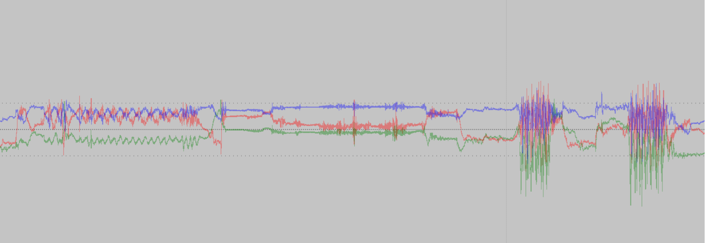
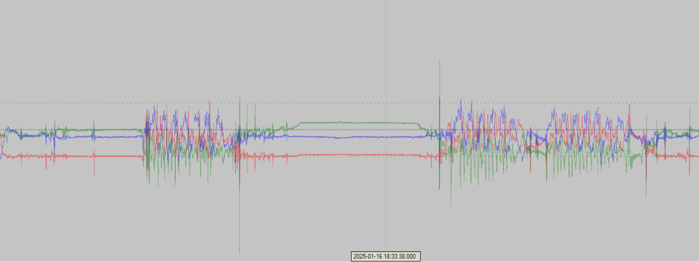

# Swimming IMU pipeline: Parkinson's disease vs control

Analysis code for the MSc project *Inertial Sensor Analysis of Swimming Movement in Parkinson's
Disease: Investigating Aquatic Motor Control through Inertial Data* (Mestrado em Bioinformática e
Biologia Computacional, Faculdade de Ciências da Universidade de Lisboa).

The pipeline takes raw accelerometer recordings (Axivity AX3, `.cwa` files) of a swimming
protocol and cuts out four exercises, using start and end times annotated by hand. It then splits
each exercise into arm-stroke or leg-kick cycles and extracts features at three time scales. The
last step compares participants with Parkinson's disease (PD) with controls.

**This repository contains no participant data and no sensor information.** You add the
recordings and two hand-written files locally (sections 2 to 4), and `.gitignore` keeps them out
of git:

- `data/participants.json`: each participant's group (PD or control) and which sensor was worn
  where;
- `data/tempos_protocolo.json`: when each exercise took place.

The scripts compute numbers and tables only; none of them draws figures.


1. [Installation](#1-installation)
2. [Where to put the data](#2-where-to-put-the-data)
3. [Participant settings: groups and sensor placement](#3-participant-settings-groups-and-sensor-placement)
4. [The manual step: exercise time windows](#4-the-manual-step-exercise-time-windows)
5. [Running the pipeline](#5-running-the-pipeline)
6. [What each script produces](#6-what-each-script-produces)
7. [Validation scripts (Chapter 4)](#7-validation-scripts-chapter-4)
8. [Where each thesis result comes from](#8-where-each-thesis-result-comes-from)

## 1. Installation

The thesis results were produced with Python 3.12 and the package versions pinned in
`requirements.txt`.

```bash
python -m venv .venv
source .venv/bin/activate        # Windows: .venv\Scripts\activate
pip install -r requirements.txt
```

`make` is included with Linux and macOS. On Windows, install it with
`winget install ezwinports.make`, or run the scripts by hand in the order listed in
[section 5](#5-running-the-pipeline).

## 2. Where to put the data

Create a `data/` folder in the repository root:

```
data/
├── participants.json            groups and sensor placement, written by hand (section 3)
├── tempos_protocolo.json        exercise time windows, written by hand (section 4)
└── sensor_data/
    ├── Patient 1/
    │   ├── 12345_0000000000.cwa
    │   ├── 23456_0000000000.cwa
    │   └── ...
    ├── Patient 2/
    └── Control 1/
```

(The file names above are made up.)

- **One folder per participant**, named with the participant's ID: `Patient N` for people with
  PD, `Control N` for controls. The ID is copied into every output file, so never use real
  names.
- **Inside each folder go the `.cwa` files**, with the names the sensors gave them. The number
  before the underscore is the sensor's serial number. The scripts identify each sensor by this
  part of the name, and section 3 explains how to record where each one was worn.
- **Up to five sensors per participant** were used in the study: both wrists, both ankles and
  the lower back. Every sensor listed in `tempos_protocolo.json` is processed, but only the four
  limb sensors enter the comparisons.

## 3. Participant settings: groups and sensor placement

### The participant table: `data/participants.json`

The recordings do not say who has PD or where each sensor was worn, and no script contains that
information. Write both by hand in `data/participants.json`, one entry per participant. This one
file is also the **sensor placement file**: for each participant it says which `.cwa` file was on
the right arm, the left arm, the right leg, the left leg and the trunk. There is no separate
placement file.

```json
{
    "Patient 1": {
        "group":     "PD",
        "right_arm": "12345_0000000000.cwa",
        "left_arm":  "23456_0000000000.cwa",
        "right_leg": "34567_0000000000.cwa",
        "left_leg":  "45678_0000000000.cwa",
        "trunk":     "56789_0000000000.cwa"
    },
    "Control 1": {
        "group":     "Control",
        "right_arm": "67890_0000000000.cwa",
        "left_arm":  "12345_0000000000.cwa",
        "right_leg": "23456_0000000000.cwa",
        "left_leg":  "34567_0000000000.cwa",
        "trunk":     "45678_0000000000.cwa"
    }
}
```

(The file names above are made up.)

| Field       | Required | What to write |
|-------------|----------|---------------|
| `group`     | yes | `"PD"` or `"Control"`: the group the participant is compared in |
| `exclude`   | no  | the reason for leaving the participant out of every PD-vs-Control comparison |
| `right_arm` | no  | the `.cwa` file of the sensor on the right wrist |
| `left_arm`  | no  | the same, left wrist |
| `right_leg` | no  | the same, right ankle |
| `left_leg`  | no  | the same, left ankle |
| `trunk`     | no  | the same, lower back |

- **First level: the participant ID.** It must be identical to the folder name in
  `data/sensor_data/` and to the participant's key in `tempos_protocolo.json`. A participant
  who is not in the table is left out of the analysis.
- **Sensor values: the exact `.cwa` file name**, as it appears in the participant's folder and in
  `tempos_protocolo.json`.
- **Only these fields are accepted.** An unknown field, or a `group` other than `"PD"` or
  `"Control"`, stops the pipeline with an error that names the participant and lists the valid
  values.
- **Sensors move between people.** The same sensor can be on an arm for one participant and on a
  leg for the next, so write each participant's entry from that session's own records.
- **Missing sensors are skipped, not fatal.** A limb that is not in the table is left out of every
  right/left and arm/leg analysis. During extraction, a swim-bout sensor without a position has its
  cycles detected with the fallback method (several candidate axes) instead of the fixed axis.
- **The trunk sensor is recorded but not analysed.** It is processed like every other sensor in
  `tempos_protocolo.json`, but no comparison uses it; the field only records which file it is.
- **To exclude a participant, add `exclude` with the reason; don't delete the entry.** The
  participant's recordings are still processed and still appear in the feature tables, but they
  are left out of every PD-vs-Control comparison. For example:

  ```json
  "Control 2": {
      "group":   "Control",
      "exclude": "Its .cwa files are byte-identical to Control 1's (thesis, Chapter 3)",
      ...the sensor fields, as for any other participant...
  }
  ```

For the thesis, the table holds 30 participants: 19 with PD and 11 controls. Control 2 is excluded
in this way, so 19 PD participants are compared with 10 controls.

**Who reads it.** `participants.py` is the only code that opens the file. Every script and notebook
that needs this information imports it from there; none keeps its own copy.

- **Groups and exclusions:** `small_window_analysis.py`, `full_window_analysis.py`,
  `analysis_granularity.py`, `radar_values.py`, `clustering_analysis.py`, `classifier_analysis.py`,
  `classifier_extended_analysis.py` and both notebooks.
- **Sensor positions:**
  - `data_analysis_medium.py` picks the detection axis during the swim bouts (Y for arm sensors,
    X for leg sensors, following Ödek & Özcan, 2023).
  - `build_isolated_summary.py`, `analysis_asymmetry.py`, the analysis scripts above and the
    notebooks pair each right limb with its left counterpart.
  - The validation scripts open the right `.cwa` file.

The fixed axes assume the sensors were strapped on the same way round as in the study. If yours
were worn differently, check which axis follows the movement (`validation/diagnose_axis_choice.py`,
section 7) and change `FIXED_AXIS_BY_LIMB` in `data_analysis_medium.py`.

### Participants used by the validation scripts

`make validation` (section 7) runs on fixed sets of participants chosen while the cycle detection
was being developed. They are settings of the tests, not information about the recordings, so they
stay at the top of each script:

| Script | List | Participants |
|--------|------|--------------|
| `validation/test_odek_ozcan_approach.py` | `SAMPLE_PATIENTS` | Patients 1, 2, 4, 5, 7, 10 and 12 |
| `validation/diagnose_axis_choice.py` | `SAMPLE_PATIENTS` | the same seven |
| `validation/test_odek_ozcan_5patients_all_ex.py` | `NEW_PATIENTS` | Patients 6, 14, 15, 16 and 20 |

Each script also sets `EXPECTED`, the number of cycles the protocol prescribes for the isolated
exercises (10). To check other participants, edit these lists. A listed participant who has no
entry in `participants.json` or no protocol times is skipped.

## 4. The manual step: exercise time windows

Each `.cwa` file is one continuous recording that covers far more than the exercises. Before
any processing, the scripts need to know when each exercise took place. That information is
written by hand into `data/tempos_protocolo.json`. This is the pipeline's only manual step;
everything after it, including the detection of individual cycles, is automatic.

### The four exercises

| Key            | Exercise |
|----------------|----------|
| `Ex_MS_Bracos` | arm movements performed in isolation, legs still |
| `Ex_MI_Pernas` | leg movements performed in isolation, arms still |
| `Ex_Swim_1`    | first attempt at the 8-metre swim, arms and legs together |
| `Ex_Swim_2`    | second attempt at the 8-metre swim |

The keys are in Portuguese: *MS* stands for *membros superiores* (upper limbs) and *MI* for
*membros inferiores* (lower limbs).

### How the windows were found

For the thesis (Section 3.2.4), the windows were annotated one recording at a time:

1. **Open the recording** in OM GUI, the viewer that Open Movement distributes for AX3 sensors.
2. **Take approximate times from the session log.** During each session, the start and end of
   every exercise were written down on a separate record, using a wall clock.
3. **Align the two clocks.** The sensor's internal clock does not match the clock of the session
   log. Move the time cursor along the recording until the logged times fall on a recognisable
   pattern of activity in the signal. Don't rely on either time source alone.
4. **Find the exercises in the signal.** They are visible in the raw three-axis acceleration
   trace, without any filtering:
   - the isolated exercise of the limb wearing the sensor shows as a stretch of regular,
     moderate-amplitude oscillation;
   - while the other limbs do their isolated exercise, this sensor is comparatively quiet;
   - each swim bout shows as a burst of high-amplitude, high-frequency activity.
5. **Read the start and end time** of each exercise from the OM GUI time cursor and write them
   into `tempos_protocolo.json` (format below).
6. **Cross-check against the participant's other sensors.** All sensors worn in one session
   record the same exercises at the same moments, so their bursts must line up. If they don't,
   redo the clock alignment from step 3 before moving on to the next recording.




*Raw three-axis acceleration in OM GUI from one session: the right-wrist sensor (top) and the
right-ankle sensor (bottom). In both traces, the earlier stretch of regular oscillation is the
isolated-limb exercise and the high-amplitude bursts towards the end are the two swim bouts. The
label on the time cursor (bottom) shows the clock time to copy into the JSON file.*

### File format

```json
{
    "Patient 1": {
        "12345_0000000000.cwa": {
            "Ex_MS_Bracos": {"start_time": "10h02m10s", "end_time": "10h02m30s"},
            "Ex_MI_Pernas": {"start_time": "10h03m05s", "end_time": "10h03m20s"},
            "Ex_Swim_1":    {"start_time": "10h04m15s", "end_time": "10h04m33s"},
            "Ex_Swim_2":    {"start_time": "10h04m50s", "end_time": "10h05m12s"}
        }
    }
}
```

(The file name and times above are made up.) Repeat the sensor block for every `.cwa` file of
the participant, and the participant block for every participant.

- **First level: the participant ID.** It must be identical to the folder name in
  `data/sensor_data/`.
- **Second level: the exact `.cwa` file name.** Files that are not listed are not processed.
- **Third level: the four exercise keys**, spelled exactly as in the table above. Give every
  sensor all four windows, whichever limb it was on. The analysis uses
  `participants.json` to decide which sensors count for which exercise: wrists for
  `Ex_MS_Bracos`, ankles for `Ex_MI_Pernas`, both for the swim bouts.
- **Times are written as `HHhMMmSSs`** on a 24-hour clock, exactly as OM GUI displays them (for
  example, `18:33:38` becomes `18h33m38s`). Do not convert time zones: the scripts read the
  times on the sensor's clock, which is the clock OM GUI shows.
- **No date is needed.** The scripts look for that time of day inside the recording.
- **One participant's sensors normally share the same windows**, since they were worn together.
  A window may differ by a second or two for a sensor where the signal requires it.
- **Edge cycles are dropped.** The first and last cycle detected in each window are treated as
  boundary cycles and excluded from the cycle features, because the window edges may cut them.
- **A bad window is skipped, not fatal.** If a time is not found in the recording, or a window is
  shorter than one second, the script prints a warning (`[AVISO]`) and skips that exercise for
  that sensor.

## 5. Running the pipeline

With the data in place and the participant settings updated, run from the repository root:

```bash
make
```

This runs every step, in the order used for the thesis:

| Command           | What it does |
|-------------------|--------------|
| `make`            | Steps 1, 2 and 3 below, one after the other. |
| `make extract`    | **Step 1.** Reads every `.cwa` file listed in `tempos_protocolo.json`, cuts out the four exercises and extracts features at the three granularities (about a minute per participant). It first deletes `Results/`, `results_medium_window/` and `results_small_window/`, so no file from an earlier run is left behind. |
| `make tables`     | **Step 2.** Compiles the extracted features into CSV tables. |
| `make results`    | **Step 3.** Dataset checks (Chapter 3), group comparisons, clustering, classifiers and the two notebooks. The slowest part of the pipeline is the 1000-permutation test in `classifier_extended_analysis.py`, which took about an hour for the thesis cohort in testing. |
| `make validation` | The Chapter 4 cycle-detection checks ([section 7](#7-validation-scripts-chapter-4)). Not part of `make`. |
| `make clean`      | Deletes every generated file. `data/` is never touched. |

Each step uses the outputs of the step before it. After editing `tempos_protocolo.json` or
`participants.json`, run `make` again. After changing only the analysis, `make results` is
enough.

Many results are printed to the console, not saved to a file. To keep a copy:

```bash
make 2>&1 | tee pipeline.log
```

If your Python executable has a different name, pass it in: `make PYTHON=python3`.

Without `make`, run the same scripts by hand, in this order, from the repository root. Delete
`Results/`, `results_medium_window/` and `results_small_window/` before re-running the first
three.

```bash
python data_analysis.py
python data_analysis_medium.py
python data_analysis_small_window.py
python analysis_results.py
python build_isolated_summary.py
python analysis_asymmetry.py
python build_full_exercise_features.py
python dataset_checks.py
# run formulas_e_contas.ipynb and analise_pd_vs_controlo.ipynb (Jupyter or VS Code)
python evolution_trajectory.py
python small_window_analysis.py
python analysis_granularity.py
python full_window_analysis.py
python radar_values.py
python clustering_analysis.py
python classifier_analysis.py
python classifier_extended_analysis.py
```

## 6. What each script produces

Files are written to the repository root unless a folder is given. Section numbers refer to the
thesis.

### Step 1: extraction

Each extractor writes one JSON file per unit of analysis, in the layout
`<folder>/<participant>/<sensor>/`. Every JSON file holds three blocks:

- `Metadata`: sensor, exercise, duration and sampling rate;
- `Clinical_Metrics`: the pipeline's own movement metrics (not clinical data);
- `TSFEL_Features`: features computed by the TSFEL library on the acceleration magnitude.

| Script | Output | Granularity |
|--------|--------|-------------|
| `data_analysis.py` | `Results/…/<exercise>_features.json` | **Full**: the whole exercise in one piece. Mechanical load and SPARC smoothness. |
| `data_analysis_medium.py` | `results_medium_window/…/<exercise>_movement_NNNN.json` | **Medium**: one file per detected cycle, with duration, mechanical load, peak and RMS acceleration, average and peak velocity, and SPARC. Cycle detection (Chapter 4) uses one fixed axis per limb (Y for wrists, X for ankles) with a 2 Hz low-pass filter. If that finds fewer than 3 peaks, it falls back to a band-pass search over several candidate signals. |
| `data_analysis_small_window.py` | `results_small_window/…/<exercise>_window_NNNN.json` | **Small**: one file per 250 ms non-overlapping window. The console message says "windows of 100ms", but the window length set in the code is 250 ms. |

### Step 2: tables

| Script | Output | Content |
|--------|--------|---------|
| `analysis_results.py` | `cycles_medium.csv` | One row per cycle (medium JSON files). |
| | `summary_medium.csv` | Per participant, sensor and exercise: cycle count, mean, SD and CV% of duration, the other cycle metrics, early/mid/late values and fatigue slopes. |
| | `windows_small.csv` | One row per 250 ms window (small JSON files). |
| | `summary_small.csv` | Per participant, sensor and exercise: mean and SD of every window metric, early/mid/late load and fatigue slopes. |
| `build_isolated_summary.py` | `cycles_by_limb.csv` | Every cycle tagged with limb and side through `participants.json`, restricted to the six exercise/limb panels used in Chapter 6: arms (isolated), legs (isolated), and arms and legs in Swim 1 and Swim 2. |
| | `isolated_metrics_summary.xlsx` | Overview of participants × panels × side. |
| `analysis_asymmetry.py` | `asymmetry_results.csv` | Right/left asymmetry index of mechanical load, per participant and panel, overall and for the early/mid/late thirds (computed from `summary_small.csv`). |
| `build_full_exercise_features.py` | `full_exercise_features.csv` | Mechanical load and SPARC per participant, sensor and exercise, compiled from `Results/`. |

### Step 3: results

Group comparisons use Welch's t-test and Cohen's *d*. The *d* denominator is
√((s₁² + s₂²) / 2), the average of the two group variances.

| Script or notebook | Output | Thesis |
|--------------------|--------|--------|
| `dataset_checks.py` | console, `dataset_checks.csv` | Chapter 3: participants per group and exclusions, exercise completeness, participants whose `.cwa` files are byte-identical (and whether their exercise windows are too), and cycles per participant. |
| `formulas_e_contas.ipynb` | `notebook_outputs/formulas_e_contas.ipynb` | Formulas worked through step by step: cycle metrics, asymmetry index, CV%, the t-test (Chapter 5). |
| `analise_pd_vs_controlo.ipynb` | `notebook_outputs/analise_pd_vs_controlo.ipynb` | Medium granularity, PD vs Control: absolute intensity, cycle-to-cycle variability (CV%), evolution across the exercise, bilateral asymmetry (§6.1.1–6.1.4), and the radar profiles. |
| `evolution_trajectory.py` | console, `evolution_trajectory.csv` | Mean ± standard error of mechanical load across normalized cycle position (10 bins), isolated arm exercise, per group: the values behind the evolution figure (§6.1.3). |
| `small_window_analysis.py` | console, `small_window_panel_data.csv` | Small granularity (§6.1.5). |
| `analysis_granularity.py` | console, `granularity_whole_exercise_results.csv` | SPARC and mechanical load as 250 ms means over the whole exercise, per panel (§6.1.5). |
| `full_window_analysis.py` | console, `full_window_panel_data.csv` | Full granularity (§6.1.6). |
| `radar_values.py` | console, `radar_values.csv` | Cohen's *d*, *z* and *p* for every metric and panel at the three granularities: the values behind the radar profiles (§6.1). |
| `clustering_analysis.py` | console, `clustering_pca.csv` | K-means clustering compared with the PD/Control labels: ARI, silhouette, variance explained by two principal components; each participant's cluster and principal-component coordinates, the values behind the clustering figure (§6.2). |
| `classifier_analysis.py` | console, `classifier_roc_points.csv` | Logistic regression and random forest with leave-one-out cross-validation: accuracy, ROC AUC, confusion matrices, feature importances, and the ROC curve points behind the classifier figure (§6.2.1). |
| `classifier_extended_analysis.py` | console | Precision, recall and F1, logistic-regression coefficients, permutation test (1000 permutations), and the feature set extended with asymmetry (§6.2.1). |

The thesis figures are not redrawn here: the repository reproduces the numbers behind them.

## 7. Validation scripts (Chapter 4)

The scripts in `validation/` check the cycle detection against the 10 repetitions the protocol
prescribes for each isolated-limb exercise. Run them with `make validation`, or one at a time
from the repository root.

| Script | What it does | Output |
|--------|--------------|--------|
| `test_segmentation.py` | Runs the adaptive multi-axis detection (the fallback method of Chapter 4, in a copy kept inside this script) on the windows in `validation/test_protocol.json`. | Console: per sensor and exercise, the peaks found on each candidate signal, the signal selected, the cycles detected with their durations, and the difference from `expected_cycles`. |
| `cycle_validation.py` | Runs the production detection (`segmentar_movimentos` in `data_analysis_medium.py`, fixed axis first, fallback if needed) on the same windows. This is Table 4.1. | Console: the table, the mean absolute error, the maximum error and the share of cases within ±1 cycle; `validation/cycle_validation.csv` |
| `test_odek_ozcan_approach.py` | Compares the detection in `test_segmentation.py` with an approach replicating Ödek & Özcan (2023): one fixed axis, 2 Hz low-pass filter, simple threshold peaks. | `validation/odek_ozcan_comparison.csv` |
| `test_odek_ozcan_5patients_all_ex.py` | The same comparison on five more participants, across all four exercises. | `validation/odek_ozcan_5patients_all_ex.csv` |
| `development_mae.py` | Combines the isolated-exercise cases of the two comparison tables above (48 for the thesis data) and gives the mean absolute error before and after the fixed-axis method: the development figures quoted in Chapter 4. Run it after those two scripts. | Console |
| `diagnose_axis_choice.py` | Counts peaks on each axis separately, to see which axis comes closest to 10 for each exercise. | `validation/axis_choice_diagnosis.csv` |

The two comparison scripts and `diagnose_axis_choice.py` read `data/tempos_protocolo.json`,
look up the right and left limb sensors in `data/participants.json`, and open those `.cwa` files for the participants listed
at the top of each script (section 3). Participants without data are skipped.

### The test windows: `validation/test_protocol.json`

`test_segmentation.py` and `cycle_validation.py` read their windows from
`validation/test_protocol.json`. Like the other two hand-written files, it is not in the repository: create it yourself. It has the same format as
`tempos_protocolo.json`, limited to the recordings and exercises you want to test, plus an
optional `expected_cycles` for each exercise: the number of cycles the participant actually
performed.

```json
{
    "Patient 1": {
        "12345_0000000000.cwa": {
            "Ex_MS_Bracos": {"start_time": "10h02m10s", "end_time": "10h02m30s", "expected_cycles": 10},
            "Ex_MI_Pernas": {"start_time": "10h03m05s", "end_time": "10h03m20s", "expected_cycles": 10},
            "Ex_Swim_1":    {"start_time": "10h04m15s", "end_time": "10h04m33s", "expected_cycles": 12},
            "Ex_Swim_2":    {"start_time": "10h04m50s", "end_time": "10h05m12s", "expected_cycles": 12}
        }
    }
}
```

(The file name, times and counts above are made up.)

- **Recordings:** `test_segmentation.py` looks for each file first in
  `data/sensor_data/<participant>/`, then in `validation/`; `cycle_validation.py` only in
  `data/sensor_data/<participant>/`.
- **Expected cycles:** if `expected_cycles` is left out, the script prints the cycles found
  without a comparison.
- **The thesis test:** for Chapter 4, the file held two sensors of one PD participant (right
  wrist and left ankle) across the four exercises. The expected count was 10 for the
  isolated-limb exercises, as the protocol prescribes. With that file, `cycle_validation.py`
  prints Table 4.1 and `test_segmentation.py` the fallback-only comparison quoted next to it.

## 8. Where each thesis result comes from

Every number, count and statistic in the thesis that comes from the recordings is produced by one
of the scripts or notebooks below. The figures are not drawn; the values behind each one are
printed or saved.

| Thesis | What it reports | Produced by | Read it in |
|--------|-----------------|-------------|------------|
| Ch. 3, Study Population | 29 participants analysed: 19 PD, 10 Control | `dataset_checks.py` (from `data/participants.json`) | console |
| Ch. 3, Data Integrity and Validation | Control 2's `.cwa` files are byte-identical to Control 1's; 27 of 29 participants have all four exercises, Patients 9 and 21 lack `Ex_Swim_2`; 34 to 229 cycles per participant | `dataset_checks.py` | console, `dataset_checks.csv` |
| Ch. 3, OM GUI figure | the manual annotation step | screenshots in `docs/` | section 4 |
| Ch. 4, development history | mean absolute error before and after the fixed-axis method: 6.29 → 2.67 cycles over 48 cases | `validation/development_mae.py` | console |
| Ch. 4, choice of axis | Y for arms, X for legs | `validation/diagnose_axis_choice.py` | `validation/axis_choice_diagnosis.csv` |
| Ch. 4, Table 4.1 | detected vs expected cycles: mean absolute error 1.25, maximum 4, 6 of 8 within ±1 | `validation/cycle_validation.py` | console, `validation/cycle_validation.csv` |
| Ch. 4, fallback-only comparison and the two fallback figures | mean absolute error 0.75 on the same 8 cases; candidate signals and detected peaks for Patient 1's right-arm sensor | `validation/test_segmentation.py` | console |
| Ch. 5, worked example | cycle 4 of Patient 1's right-arm sensor in `Ex_MS_Bracos` | `data_analysis_medium.py`, then `build_isolated_summary.py` | a row of `cycles_by_limb.csv` |
| Ch. 5, pipeline figure | the processing steps | `docs/pipeline_overview.png` | top of this README |
| §6.1.1–6.1.4 | absolute intensity, CV%, slopes (with the per-patient slope signs) and asymmetry at medium granularity | `analise_pd_vs_controlo.ipynb` | `notebook_outputs/analise_pd_vs_controlo.ipynb` |
| §6.1.3, evolution figure | mean ± standard error of force across the isolated arm exercise | `evolution_trajectory.py` | `evolution_trajectory.csv` |
| §6.1.5 | small-granularity tables | `small_window_analysis.py`, `analysis_granularity.py` | console, `small_window_panel_data.csv`, `granularity_whole_exercise_results.csv` |
| §6.1.6 | full-granularity tables | `full_window_analysis.py` | console, `full_window_panel_data.csv` |
| §6.1.7 | granularity synthesis | the *d* values of the three intensity tables above | those tables, or `radar_values.csv` |
| §6.1, 6.1.5, 6.1.6, radar figures | *d*, *z* and *p* for every spoke | `radar_values.py` | `radar_values.csv` |
| §6.2, clustering and its figure | ARI, silhouette, variance explained; each participant's cluster and coordinates | `clustering_analysis.py` | console, `clustering_pca.csv` |
| §6.2.1, classifier table and figure | accuracy, ROC AUC, confusion matrices, ROC curves | `classifier_analysis.py` | console, `classifier_roc_points.csv` |
| §6.2.1, further tables | precision, recall, F1, feature importance, permutation test, six-feature classifier | `classifier_extended_analysis.py` | console |
| Ch. 7 | summaries of the results above | (no new computation) | |

`formulas_e_contas.ipynb` works through the formulas of Chapter 5 on the same tables.

### A fresh run compared with the thesis numbers

The code in this repository is the code that produced the thesis. Run on the extraction outputs
the thesis was built from, it reproduces every table. A completely fresh run (`make`, starting
from the raw recordings) reproduces exactly:

- Chapters 3, 4 and 5;
- the medium-granularity tables (§6.1.1–6.1.3);
- the clustering;
- the five-feature classifiers and the permutation test.

Some values built from the small and full extractions come out differently, because two things
were different in the extraction the thesis used:

1. **Leftover files.** It still held 11 small-window files from an earlier run, for Patient 1's
   right-arm sensor in `Ex_MS_Bracos`. `make extract` deletes old outputs before extracting.
2. **Control 6's leg sensors.** Their small- and full-window outputs were missing, because they
   had not been extracted again after a timestamp fix. The leg panels therefore had 9 controls
   instead of 10.

| Thesis section | Table cells that differ in a fresh run |
|----------------|----------------------------------------|
| §6.1.1–6.1.3 (medium: intensity, CV%, slopes) | 0 of 504 |
| §6.1.4 (asymmetry) | 19 of 42 |
| §6.1.5 (small window: intensity, CV%, evolution) | 72 of 252 |
| §6.1.6 (full window: intensity, asymmetry) | 38 of 126 |

One p-value crosses 0.05: the small-window Swim 1 (Legs) SPARC slope, 0.055 in the thesis and
0.040 in a fresh run. The results built on these tables move with them: the granularity synthesis
(§6.1.7), the small- and full-granularity radar profiles, and the six-feature classifier (§6.2.1),
which uses the asymmetry index.
