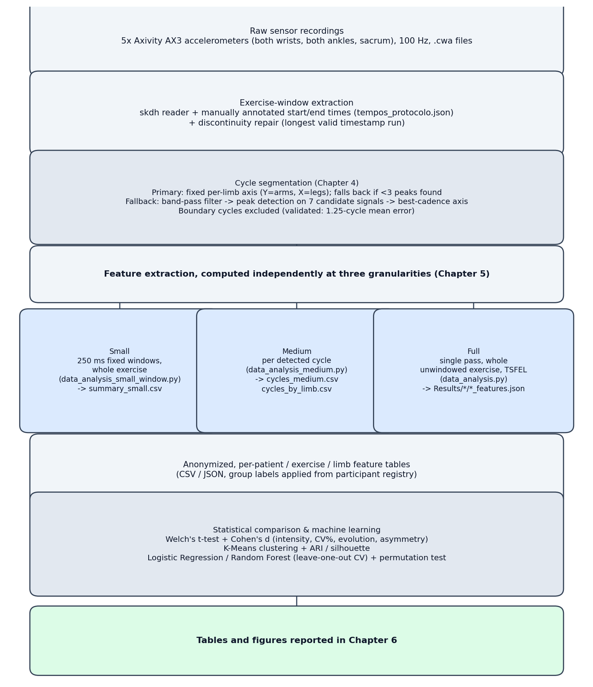

# Swimming IMU pipeline: Parkinson's disease vs control

Analysis code for the MSc project *Inertial Sensor Analysis of Swimming Movement in Parkinson's
Disease: Investigating Aquatic Motor Control through Inertial Data* (Mestrado em Bioinformática e
Biologia Computacional, Faculdade de Ciências da Universidade de Lisboa).

The pipeline takes raw accelerometer recordings (Axivity AX3, `.cwa` files) of a swimming
protocol and cuts out four exercises, using start and end times annotated by hand. It then splits
each exercise into arm-stroke or leg-kick cycles and extracts features at three time scales. The
last step compares participants with Parkinson's disease (PD) with controls.

**This repository contains no participant data and no sensor information.** You add the
recordings and two hand-written files locally (sections 2 to 4), and `.gitignore` keeps them out
of git:

- `data/sensor_placement.json`: which sensor was worn on which limb;
- `data/tempos_protocolo.json`: when each exercise took place.

The scripts compute numbers and tables only; none of them draws figures.



1. [Installation](#1-installation)
2. [Where to put the data](#2-where-to-put-the-data)
3. [Participant settings](#3-participant-settings)
4. [The manual step: exercise time windows](#4-the-manual-step-exercise-time-windows)
5. [Running the pipeline](#5-running-the-pipeline)
6. [What each script produces](#6-what-each-script-produces)
7. [Validation scripts (Chapter 4)](#7-validation-scripts-chapter-4)

## 1. Installation

The thesis results were produced with Python 3.12 and the package versions pinned in
`requirements.txt`.

```bash
python -m venv .venv
source .venv/bin/activate        # Windows: .venv\Scripts\activate
pip install -r requirements.txt
```

`make` is included with Linux and macOS. On Windows, install it with
`winget install ezwinports.make`, or run the scripts by hand in the order listed in
[section 5](#5-running-the-pipeline).

## 2. Where to put the data

Create a `data/` folder in the repository root:

```
data/
├── sensor_placement.json        which sensor was on which limb, written by hand (section 3)
├── tempos_protocolo.json        exercise time windows, written by hand (section 4)
└── sensor_data/
    ├── Patient 1/
    │   ├── 12345_0000000000.cwa
    │   ├── 23456_0000000000.cwa
    │   └── ...
    ├── Patient 2/
    └── Control 1/
```

(The file names above are made up.)

- **One folder per participant**, named with the participant's ID: `Patient N` for people with
  PD, `Control N` for controls. The ID is copied into every output file, so never use real
  names.
- **Inside each folder go the `.cwa` files**, with the names the sensors gave them. The number
  before the underscore is the sensor's serial number. The scripts identify each sensor by this
  part of the name, and section 3 explains how to record where each one was worn.
- **Up to five sensors per participant** were used in the study: both wrists, both ankles and
  the lower back. Every sensor listed in `tempos_protocolo.json` is processed, but only the four
  limb sensors enter the comparisons.

## 3. Participant settings

### Sensor placement: `data/sensor_placement.json`

The recordings do not say where each sensor was worn, and no script contains that information.
Write it by hand in `data/sensor_placement.json`, one entry per participant:

```json
{
    "Patient 1": {
        "right_arm": "12345_0000000000.cwa",
        "left_arm":  "23456_0000000000.cwa",
        "right_leg": "34567_0000000000.cwa",
        "left_leg":  "45678_0000000000.cwa"
    },
    "Patient 2": {
        "right_arm": "56789_0000000000.cwa",
        "left_arm":  "12345_0000000000.cwa",
        "right_leg": "23456_0000000000.cwa",
        "left_leg":  "67890_0000000000.cwa"
    }
}
```

(The file names above are made up.)

| Key         | Where the sensor was worn |
|-------------|---------------------------|
| `right_arm` | right wrist |
| `left_arm`  | left wrist |
| `right_leg` | right ankle |
| `left_leg`  | left ankle |

- **First level: the participant ID.** It must be identical to the folder name in
  `data/sensor_data/`.
- **Values: the exact `.cwa` file name**, as it appears in the participant's folder and in
  `tempos_protocolo.json`.
- **Only these four keys are accepted.** Any other key stops the pipeline with an error that
  lists the valid ones. The lower-back sensor is not listed: it is processed but not used in
  any comparison.
- **Sensors move between people.** The same sensor can be on an arm for one participant and on a
  leg for the next, so write each participant's entry from that session's own records.
- **Missing entries are skipped, not fatal.** A participant or position that is not in the file
  is left out of every right/left and arm/leg analysis. During extraction, a swim-bout sensor
  without a position has its cycles detected with the fallback method (several candidate axes)
  instead of the fixed axis.

`sensor_placement.py` is the only code that reads this file. The extractor
`data_analysis_medium.py` uses the placement to pick the detection axis during the swim bouts (Y
for arm sensors, X for leg sensors, following Ödek & Özcan, 2023). The analysis scripts and
notebooks use it to pair each right limb with its left counterpart. The fixed axes assume the
sensors were strapped on the same way round as in the study. If yours were worn differently,
check which axis follows the movement (`validation/diagnose_axis_choice.py`, section 7) and
change `FIXED_AXIS_BY_LIMB` in `data_analysis_medium.py`.

### Participant list and groups (in the code)

**Participant list: `participants.json`.** The IDs to analyse. Most analysis scripts skip any
participant that is not on this list.

**Groups: `PD_ALL` and `CONTROL_ALL`.** These two lists decide who is compared with whom. The
same lists are repeated in:

- `small_window_analysis.py`
- `full_window_analysis.py`
- `radar_values.py`
- `clustering_analysis.py`
- `classifier_analysis.py`
- `classifier_extended_analysis.py`
- `analise_pd_vs_controlo.ipynb` (notebook section 3)

Two files define the groups differently:
- `formulas_e_contas.ipynb` has its own lists, `PD_PATIENTS` and `CONTROL_PATIENTS`.
- `analysis_granularity.py` takes the group from the ID prefix.

As shipped, the lists hold the thesis cohort: 19 PD participants and 10 controls, with
`Control 2` excluded. When you analyse a different cohort, update them.

## 4. The manual step: exercise time windows

Each `.cwa` file is one continuous recording that covers far more than the exercises. Before
any processing, the scripts need to know when each exercise took place. That information is
written by hand into `data/tempos_protocolo.json`. This is the pipeline's only manual step;
everything after it, including the detection of individual cycles, is automatic.

### The four exercises

| Key            | Exercise |
|----------------|----------|
| `Ex_MS_Bracos` | arm movements performed in isolation, legs still |
| `Ex_MI_Pernas` | leg movements performed in isolation, arms still |
| `Ex_Swim_1`    | first attempt at the 8-metre swim, arms and legs together |
| `Ex_Swim_2`    | second attempt at the 8-metre swim |

The keys are in Portuguese: *MS* stands for *membros superiores* (upper limbs) and *MI* for
*membros inferiores* (lower limbs).

### How the windows were found

For the thesis (Section 3.2.4), the windows were annotated one recording at a time:

1. **Open the recording** in OM GUI, the viewer that Open Movement distributes for AX3 sensors.
2. **Take approximate times from the session log.** During each session, the start and end of
   every exercise were written down on a separate record, using a wall clock.
3. **Align the two clocks.** The sensor's internal clock does not match the clock of the session
   log. Move the time cursor along the recording until the logged times fall on a recognisable
   pattern of activity in the signal. Don't rely on either time source alone.
4. **Find the exercises in the signal.** They are visible in the raw three-axis acceleration
   trace, without any filtering:
   - the isolated exercise of the limb wearing the sensor shows as a stretch of regular,
     moderate-amplitude oscillation;
   - while the other limbs do their isolated exercise, this sensor is comparatively quiet;
   - each swim bout shows as a burst of high-amplitude, high-frequency activity.
5. **Read the start and end time** of each exercise from the OM GUI time cursor and write them
   into `tempos_protocolo.json` (format below).
6. **Cross-check against the participant's other sensors.** All sensors worn in one session
   record the same exercises at the same moments, so their bursts must line up. If they don't,
   redo the clock alignment from step 3 before moving on to the next recording.


*Raw three-axis acceleration in OM GUI from one session: the right-wrist sensor (top) and the
right-ankle sensor (bottom). In both traces, the earlier stretch of regular oscillation is the
isolated-limb exercise and the high-amplitude bursts towards the end are the two swim bouts. The
label on the time cursor (bottom) shows the clock time to copy into the JSON file.*

### File format

```json
{
    "Patient 1": {
        "12345_0000000000.cwa": {
            "Ex_MS_Bracos": {"start_time": "10h02m10s", "end_time": "10h02m30s"},
            "Ex_MI_Pernas": {"start_time": "10h03m05s", "end_time": "10h03m20s"},
            "Ex_Swim_1":    {"start_time": "10h04m15s", "end_time": "10h04m33s"},
            "Ex_Swim_2":    {"start_time": "10h04m50s", "end_time": "10h05m12s"}
        }
    }
}
```

(The file name and times above are made up.) Repeat the sensor block for every `.cwa` file of
the participant, and the participant block for every participant.

- **First level: the participant ID.** It must be identical to the folder name in
  `data/sensor_data/`.
- **Second level: the exact `.cwa` file name.** Files that are not listed are not processed.
- **Third level: the four exercise keys**, spelled exactly as in the table above. Give every
  sensor all four windows, whichever limb it was on. The analysis uses
  `sensor_placement.json` to decide which sensors count for which exercise: wrists for
  `Ex_MS_Bracos`, ankles for `Ex_MI_Pernas`, both for the swim bouts.
- **Times are written as `HHhMMmSSs`** on a 24-hour clock, exactly as OM GUI displays them (for
  example, `18:33:38` becomes `18h33m38s`). Do not convert time zones: the scripts read the
  times on the sensor's clock, which is the clock OM GUI shows.
- **No date is needed.** The scripts look for that time of day inside the recording.
- **One participant's sensors normally share the same windows**, since they were worn together.
  A window may differ by a second or two for a sensor where the signal requires it.
- **Edge cycles are dropped.** The first and last cycle detected in each window are treated as
  boundary cycles and excluded from the cycle features, because the window edges may cut them.
- **A bad window is skipped, not fatal.** If a time is not found in the recording, or a window is
  shorter than one second, the script prints a warning (`[AVISO]`) and skips that exercise for
  that sensor.

## 5. Running the pipeline

With the data in place and the participant settings updated, run from the repository root:

```bash
make
```

This runs every step, in the order used for the thesis:

| Command           | What it does |
|-------------------|--------------|
| `make`            | Steps 1, 2 and 3 below, one after the other. |
| `make extract`    | **Step 1.** Reads every `.cwa` file listed in `tempos_protocolo.json`, cuts out the four exercises and extracts features at the three granularities (about a minute per participant). It first deletes `Results/`, `results_medium_window/` and `results_small_window/`, so no file from an earlier run is left behind. |
| `make tables`     | **Step 2.** Compiles the extracted features into CSV tables. |
| `make results`    | **Step 3.** Group comparisons, clustering, classifiers and the two notebooks. The slowest part of the pipeline is the 1000-permutation test in `classifier_extended_analysis.py`, which took about an hour for the thesis cohort in testing. |
| `make validation` | The Chapter 4 cycle-detection checks ([section 7](#7-validation-scripts-chapter-4)). Not part of `make`. |
| `make clean`      | Deletes every generated file. `data/` is never touched. |

Each step uses the outputs of the step before it. After editing `tempos_protocolo.json` or
`sensor_placement.json`, run `make` again. After changing only the analysis, `make results` is
enough.

Many results are printed to the console, not saved to a file. To keep a copy:

```bash
make 2>&1 | tee pipeline.log
```

If your Python executable has a different name, pass it in: `make PYTHON=python3`.

Without `make`, run the same scripts by hand, in this order, from the repository root. Delete
`Results/`, `results_medium_window/` and `results_small_window/` before re-running the first
three.

```bash
python data_analysis.py
python data_analysis_medium.py
python data_analysis_small_window.py
python analysis_results.py
python build_isolated_summary.py
python analysis_asymmetry.py
python build_full_exercise_features.py
# run formulas_e_contas.ipynb and analise_pd_vs_controlo.ipynb (Jupyter or VS Code)
python small_window_analysis.py
python analysis_granularity.py
python full_window_analysis.py
python radar_values.py
python clustering_analysis.py
python classifier_analysis.py
python classifier_extended_analysis.py
```

## 6. What each script produces

Files are written to the repository root unless a folder is given. Section numbers refer to the
thesis.

### Step 1: extraction

Each extractor writes one JSON file per unit of analysis, in the layout
`<folder>/<participant>/<sensor>/`. Every JSON file holds three blocks:

- `Metadata`: sensor, exercise, duration and sampling rate;
- `Clinical_Metrics`: the pipeline's own movement metrics (not clinical data);
- `TSFEL_Features`: features computed by the TSFEL library on the acceleration magnitude.

| Script | Output | Granularity |
|--------|--------|-------------|
| `data_analysis.py` | `Results/…/<exercise>_features.json` | **Full**: the whole exercise in one piece. Mechanical load and SPARC smoothness. |
| `data_analysis_medium.py` | `results_medium_window/…/<exercise>_movement_NNNN.json` | **Medium**: one file per detected cycle, with duration, mechanical load, peak and RMS acceleration, average and peak velocity, and SPARC. Cycle detection (Chapter 4) uses one fixed axis per limb (Y for wrists, X for ankles) with a 2 Hz low-pass filter. If that finds fewer than 3 peaks, it falls back to a band-pass search over several candidate signals. |
| `data_analysis_small_window.py` | `results_small_window/…/<exercise>_window_NNNN.json` | **Small**: one file per 250 ms non-overlapping window. The console message says "windows of 100ms", but the window length set in the code is 250 ms. |

### Step 2: tables

| Script | Output | Content |
|--------|--------|---------|
| `analysis_results.py` | `cycles_medium.csv` | One row per cycle (medium JSON files). |
| | `summary_medium.csv` | Per participant, sensor and exercise: cycle count, mean, SD and CV% of duration, the other cycle metrics, early/mid/late values and fatigue slopes. |
| | `windows_small.csv` | One row per 250 ms window (small JSON files). |
| | `summary_small.csv` | Per participant, sensor and exercise: mean and SD of every window metric, early/mid/late load and fatigue slopes. |
| `build_isolated_summary.py` | `cycles_by_limb.csv` | Every cycle tagged with limb and side through `sensor_placement.json`, restricted to the six exercise/limb panels used in Chapter 6: arms (isolated), legs (isolated), and arms and legs in Swim 1 and Swim 2. |
| | `isolated_metrics_summary.xlsx` | Overview of participants × panels × side. |
| `analysis_asymmetry.py` | `asymmetry_results.csv` | Right/left asymmetry index of mechanical load, per participant and panel, overall and for the early/mid/late thirds (computed from `summary_small.csv`). |
| `build_full_exercise_features.py` | `full_exercise_features.csv` | Mechanical load and SPARC per participant, sensor and exercise, compiled from `Results/`. |

### Step 3: results

Group comparisons use Welch's t-test and Cohen's *d*. The *d* denominator is
√((s₁² + s₂²) / 2), the average of the two group variances.

| Script or notebook | Output | Thesis |
|--------------------|--------|--------|
| `formulas_e_contas.ipynb` | `notebook_outputs/formulas_e_contas.ipynb` | Formulas worked through step by step: cycle metrics, asymmetry index, CV%, the t-test (Chapter 5). |
| `analise_pd_vs_controlo.ipynb` | `notebook_outputs/analise_pd_vs_controlo.ipynb` | Medium granularity, PD vs Control: absolute intensity, cycle-to-cycle variability (CV%), evolution across the exercise, bilateral asymmetry (§6.1.1–6.1.4), and the radar profiles. |
| `small_window_analysis.py` | console, `small_window_panel_data.csv` | Small granularity (§6.1.5). |
| `analysis_granularity.py` | console, `granularity_whole_exercise_results.csv` | SPARC and mechanical load as 250 ms means over the whole exercise, per panel (§6.1.5). |
| `full_window_analysis.py` | console, `full_window_panel_data.csv` | Full granularity (§6.1.6). |
| `radar_values.py` | console, `radar_values.csv` | Cohen's *d*, *z* and *p* for every metric and panel at the three granularities: the values behind the radar profiles (§6.1). |
| `clustering_analysis.py` | console | K-means clustering compared with the PD/Control labels: ARI, silhouette, variance explained by two principal components (§6.2). |
| `classifier_analysis.py` | console | Logistic regression and random forest with leave-one-out cross-validation: accuracy, ROC AUC, confusion matrices, feature importances (§6.2.1). |
| `classifier_extended_analysis.py` | console | Precision, recall and F1, logistic-regression coefficients, permutation test (1000 permutations), and the feature set extended with asymmetry (§6.2.1). |

The thesis figures are not redrawn here: the repository reproduces the numbers behind them.

## 7. Validation scripts (Chapter 4)

The scripts in `validation/` check the cycle detection against the 10 repetitions the protocol
prescribes for each isolated-limb exercise. Run them with `make validation`, or one at a time
from the repository root.

| Script | What it does | Output |
|--------|--------------|--------|
| `test_segmentation.py` | Runs the adaptive multi-axis detection (the fallback method of Chapter 4, in a copy kept inside this script) on the windows in `validation/test_protocol.json`. | Console: per sensor and exercise, the peaks found on each candidate signal, the signal selected, the cycles detected with their durations, and the difference from `expected_cycles`. |
| `test_odek_ozcan_approach.py` | Compares the detection in `test_segmentation.py` with an approach replicating Ödek & Özcan (2023): one fixed axis, 2 Hz low-pass filter, simple threshold peaks. | `validation/odek_ozcan_comparison.csv` |
| `test_odek_ozcan_5patients_all_ex.py` | The same comparison on five more participants, across all four exercises. | `validation/odek_ozcan_5patients_all_ex.csv` |
| `diagnose_axis_choice.py` | Counts peaks on each axis separately, to see which axis comes closest to 10 for each exercise. | `validation/axis_choice_diagnosis.csv` |

The other three scripts read `data/tempos_protocolo.json`, look up the right and left limb
sensors in `data/sensor_placement.json`, and open those `.cwa` files for the participants listed
at the top of each script. Participants without data are skipped.

### The test windows: `validation/test_protocol.json`

`test_segmentation.py` reads its windows from `validation/test_protocol.json`. Like the other two
hand-written files, it is not in the repository: create it yourself. It has the same format as
`tempos_protocolo.json`, limited to the recordings and exercises you want to test, plus an
optional `expected_cycles` for each exercise: the number of cycles the participant actually
performed.

```json
{
    "Patient 1": {
        "12345_0000000000.cwa": {
            "Ex_MS_Bracos": {"start_time": "10h02m10s", "end_time": "10h02m30s", "expected_cycles": 10},
            "Ex_MI_Pernas": {"start_time": "10h03m05s", "end_time": "10h03m20s", "expected_cycles": 10},
            "Ex_Swim_1":    {"start_time": "10h04m15s", "end_time": "10h04m33s", "expected_cycles": 12},
            "Ex_Swim_2":    {"start_time": "10h04m50s", "end_time": "10h05m12s", "expected_cycles": 12}
        }
    }
}
```

(The file name, times and counts above are made up.)

- **Recordings:** the script looks for each file first in `data/sensor_data/<participant>/`,
  then in `validation/`.
- **Expected cycles:** if `expected_cycles` is left out, the script prints the cycles found
  without a comparison.
- **The thesis test:** for Chapter 4, the file held two sensors of one PD participant (right
  wrist and left ankle) across the four exercises. The expected count was 10 for the
  isolated-limb exercises, as the protocol prescribes.
